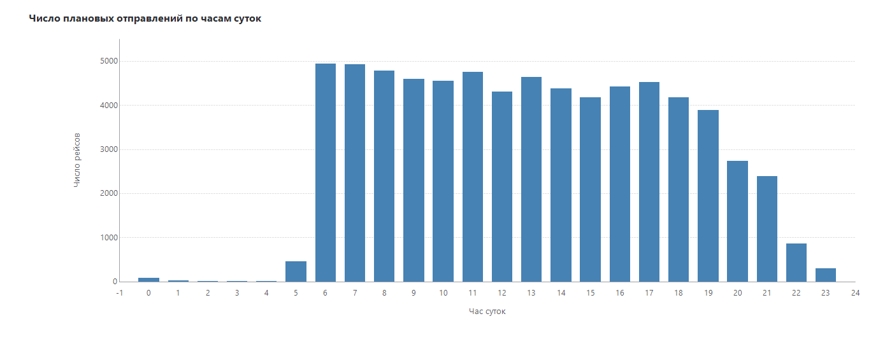
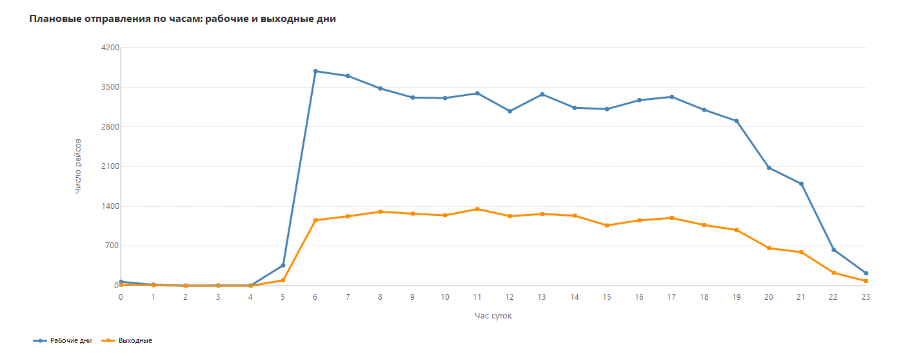

# Лабораторная работа №2. Временные признаки и внутрисуточная структура рейсов

**Данные:** `flights_2008.csv` — 70 000 рейсов, 29 признаков.
**Вариант:** 1 — внутрисуточная структура отправлений.

## Цель работы

Сформировать корректные временные признаки (дата, время в минутах, час суток, признак выходного дня) и описать, как распределяются плановые отправления по часам, различаются ли рабочие и выходные дни.

## 1. Формирование временных признаков

**Дата рейса.** `FlightDate` собирается из трёх числовых полей `Year`, `Month`, `DayofMonth`. Проверка показала: месяц во всех 70 000 строк лежит в диапазоне 1–12, день месяца — в 1–31, число пропусков в этих полях — 0. Все 70 000 дат корректны, год единственный — 2008.

**Время из формата HHMM.** Поля времени записаны числом вида `2055` (20:55). Преобразование: часы = целая часть от деления на 100, минуты = остаток; результат — минуты от начала суток. Отдельно обработан случай `2400` → 0 минут. Некорректные значения (часы вне 0–23, минуты вне 0–59) дают пропуск.

| Поле | Валидных значений | Пропусков | Некорректных значений |
|---|---:|---:|---:|
| CRSDepTime | 70 000 | 0 | 0 |
| CRSArrTime | 70 000 | 0 | 0 |
| DepTime | 68 601 | 1 399 | 0 |
| ArrTime | 68 444 | 1 556 | 0 |

Плановые времена заполнены всегда и всегда корректны. Пропуски в фактических временах соответствуют отменённым рейсам; «битых» значений формата HHMM в наборе нет.

**Производные признаки.** `ScheduledDepartureHour` — час планового вылета (0–23); `IsWeekend` — признак дня 6 или 7 (`DayOfWeek`), то есть суббота или воскресенье.

## 2. Распределение отправлений по часам суток

| Час | Всего рейсов | Рабочие дни | Выходные | Доля в будни, % | Доля в выходные, % |
|---:|---:|---:|---:|---:|---:|
| 0 | 90 | 71 | 19 | 0,14 | 0,10 |
| 1 | 28 | 19 | 9 | 0,04 | 0,05 |
| 2 | 6 | 4 | 2 | 0,01 | 0,01 |
| 3 | 8 | 7 | 1 | 0,01 | 0,01 |
| 4 | 8 | 7 | 1 | 0,01 | 0,01 |
| 5 | 460 | 362 | 98 | 0,70 | 0,53 |
| 6 | **4 944** | 3 785 | 1 159 | 7,35 | 6,27 |
| 7 | 4 927 | 3 701 | 1 226 | 7,18 | 6,64 |
| 8 | 4 787 | 3 480 | 1 307 | 6,75 | 7,08 |
| 9 | 4 592 | 3 320 | 1 272 | 6,44 | 6,89 |
| 10 | 4 554 | 3 311 | 1 243 | 6,43 | 6,73 |
| 11 | 4 750 | 3 395 | 1 355 | 6,59 | 7,34 |
| 12 | 4 308 | 3 080 | 1 228 | 5,98 | 6,65 |
| 13 | 4 643 | 3 376 | 1 267 | 6,55 | 6,86 |
| 14 | 4 376 | 3 139 | 1 237 | 6,09 | 6,70 |
| 15 | 4 183 | 3 117 | 1 066 | 6,05 | 5,77 |
| 16 | 4 430 | 3 274 | 1 156 | 6,35 | 6,26 |
| 17 | 4 529 | 3 332 | 1 197 | 6,47 | 6,48 |
| 18 | 4 175 | 3 103 | 1 072 | 6,02 | 5,80 |
| 19 | 3 892 | 2 907 | 985 | 5,64 | 5,33 |
| 20 | 2 744 | 2 080 | 664 | 4,04 | 3,59 |
| 21 | 2 392 | 1 799 | 593 | 3,49 | 3,21 |
| 22 | 867 | 636 | 231 | 1,23 | 1,25 |
| 23 | 307 | 223 | 84 | 0,43 | 0,45 |

**Час максимальной интенсивности — 6:00, 4 944 рейса (7,06 % суточного объёма).** Сразу за ним идут 7:00 (4 927) и 8:00 (4 787), затем 11:00 (4 750). Минимум приходится на 2:00 — 6 рейсов; интервал 1:00–4:00 практически не используется.

Форма распределения: резкий подъём с 5:00 к утреннему пику, плато 8:00–19:00 в диапазоне 3 892–4 787 рейсов в час, затем спад после 20:00 и почти полное затухание к полуночи.

## 3. Рабочие и выходные дни

| Показатель | Рабочие дни | Выходные |
|---|---:|---:|
| Рейсов всего | 51 528 | 18 472 |
| Доля набора, % | 73,61 | 26,39 |
| Доля рейсов в 00:00–08:00, % | 22,19 | 20,69 |
| Доля рейсов в 08:00–14:00, % | 44,83 | 48,25 |
| Доля рейсов в 18:00–23:00, % | 20,86 | 19,65 |

В 2008 году 262 будних и 104 выходных дня, поэтому пересчёт на день даёт ≈ 196,7 рейса в будний день против ≈ 177,6 в выходной — примерно на 10 % меньше.

Структура спада различается. В выходные **меньше доля раннеутренних рейсов** (20,69 % против 22,19 % в интервале 00:00–08:00) и **меньше доля вечерних** (19,65 % против 20,86 %), а **доля дневных рейсов, наоборот, выше** — 48,25 % против 44,83 %. Пик выходного дня сдвинут в сторону середины дня: доли часов 8–14 в выходные выше будничных почти на каждом часе (например, 11:00 — 7,34 % против 6,59 %), а часов 5–7 и 15–19 — ниже.

Иными словами, будний день концентрируется в двух «горбах» (утренний разлёт и вечерний возврат), а выходной распределён ровнее и смещён к дневным часам.

## Выводы

- Плановые времена в наборе полны и корректны, преобразование HHMM → минуты прошло без потерь; пропуски фактических времён объясняются отменой рейсов.
- Внутрисуточная структура резко неравномерна: утренний пик в 6:00 (4 944 рейса), плато 8:00–19:00, глухой ночной провал 1:00–4:00.
- Выходные отличаются не только объёмом (на ~10 % меньше рейсов в день), но и формой: меньше ранних и вечерних отправлений, больше дневных.
- Признак `IsWeekend` и час отправления — рабочие признаки для дальнейшего анализа задержек.

## Ограничения

- Время в наборе — **локальное время аэропорта**. Агрегирование по часам смешивает разные часовые пояса: рейс в 6:00 по Нью-Йорку и в 6:00 по Лос-Анджелесу попадают в один столбец, хотя фактически разнесены на три часа. Для анализа суточных циклов это приемлемо, для расчёта нагрузки на систему — нет.
- В наборе нет полного календаря праздников, поэтому «выходной» определён только по дню недели; праздничные дни учтены как будни.
- Часы 0–4 содержат единичные рейсы, и их доли (< 0,15 %) статистически неустойчивы.
