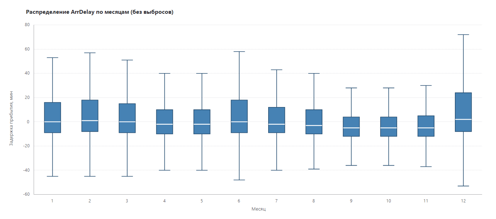
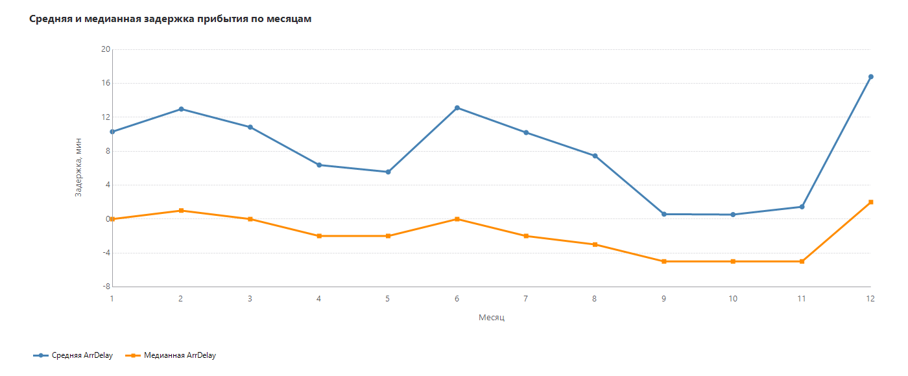
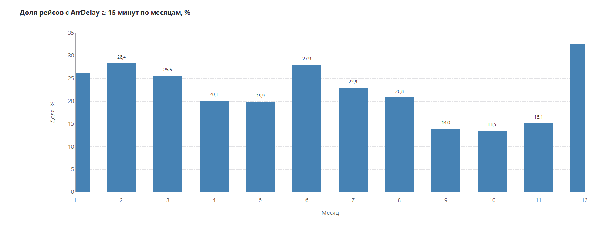

# Лабораторная работа №4. Задержки рейсов: описательные статистики и месячная динамика

**Данные:** `flights_2008.csv` — аналитическая выборка 68 417 выполненных рейсов.
**Вариант:** 1 — сравнение задержек по месяцам.

## Цель работы

Описать распределения задержек вылета и прибытия, оценить долю рейсов за разными порогами и выяснить, как меняется уровень задержек по месяцам 2008 года.

## 1. Аналитическая выборка

Выборка формируется из набора по трём условиям:

1. рейс выполнен: `Cancelled = 0` и `Diverted = 0`;
2. известны обе задержки: `DepDelay` и `ArrDelay` не пусты;
3. запись не содержит критических ошибок качества (проверки из работы №3: диапазоны дат, допустимые статусы, положительные расстояние и продолжительность, неотрицательное руление).

Итог: **68 417 рейсов** из 70 000 (97,74 %). Отсеяно 1 583 записи — отменённые, перенаправленные и записи без фактических задержек.

## 2. Описательные статистики задержек

| Статистика | DepDelay (вылет), мин | ArrDelay (прибытие), мин |
|---|---:|---:|
| Число наблюдений | 68 417 | 68 417 |
| Среднее | 9,92 | 8,08 |
| Стандартное отклонение | 34,69 | 37,89 |
| Минимум | −45 | −68 |
| 1-й процентиль | −12 | −30 |
| 5-й процентиль | −9 | −21 |
| 10-й процентиль | −7 | −17 |
| 25-й процентиль | −4 | −10 |
| Медиана | −1 | −2 |
| 75-й процентиль | 8 | 12 |
| 90-й процентиль | 37 | 41 |
| 95-й процентиль | 70 | 74 |
| 99-й процентиль | 163 | 170 |
| Максимум | 1 146 | 1 148 |

Распределения сильно асимметричны: медиана близка к нулю (−1 и −2 мин), а среднее положительно (9,92 и 8,08 мин). Разрыв между медианой и средним — около 10 минут — создают редкие, но очень большие задержки: 99-й процентиль 163–170 минут, максимум превышает 19 часов. Стандартное отклонение (34,69 и 37,89) больше среднего, что также указывает на тяжёлый правый хвост.

Разброс прибытия шире, чем разброс вылета: разница между 5-м и 95-м процентилями составляет 95 минут для `DepDelay` и 95 минут для `ArrDelay`, но крайние значения у прибытия дальше (−68 против −45; 1 148 против 1 146). Часть задержки вылета компенсируется в воздухе.

## 3. Доли рейсов за порогами

| Порог, мин | Вылет: рейсов | Вылет: доля, % | Прибытие: рейсов | Прибытие: доля, % |
|---:|---:|---:|---:|---:|
| ≥ 0 | 32 281 | 47,18 | 31 490 | 46,03 |
| ≥ 15 | 13 344 | 19,50 | 15 252 | 22,29 |
| ≥ 30 | 8 339 | 12,19 | 9 221 | 13,48 |
| ≥ 60 | 4 196 | 6,13 | 4 555 | 6,66 |
| ≥ 120 | 1 410 | 2,06 | 1 540 | 2,25 |
| ≥ 180 | 534 | 0,78 | 575 | 0,84 |

Чуть меньше половины рейсов отправляются и прилетают вовремя или раньше (47,18 % и 46,03 %). Каждый пятый рейс опаздывает на прибытие на 15 минут и более (22,29 %), каждый четырнадцатый — на час и более (6,66 %). Доля опозданий по прибытию систематически выше, чем по вылету, на всех порогах — задержка в пути чаще увеличивается, чем компенсируется.

## 4. Вариант 1. Сравнение по месяцам

| Месяц | Рейсов | Средняя DepDelay | Медиана DepDelay | Средняя ArrDelay | Медиана ArrDelay | p90 ArrDelay | Доля ≥ 15 мин, % | Доля ≥ 60 мин, % |
|---:|---:|---:|---:|---:|---:|---:|---:|---:|
| 1 | 6 069 | 11,69 | 0 | 10,31 | 0 | 46 | 26,18 | 7,22 |
| 2 | 5 296 | 13,15 | 0 | 12,98 | 1 | 54 | 28,38 | 8,63 |
| 3 | 5 856 | 12,20 | 0 | 10,85 | 0 | 47 | 25,53 | 7,63 |
| 4 | 5 870 | 7,94 | −1 | 6,38 | −2 | 34 | 20,09 | 5,14 |
| 5 | 6 074 | 7,28 | −1 | 5,56 | −2 | 33 | 19,87 | 5,15 |
| 6 | 5 909 | 13,65 | 0 | 13,13 | 0 | 56 | 27,94 | 9,41 |
| 7 | 6 086 | 12,03 | −1 | 10,21 | −2 | 47 | 22,92 | 8,12 |
| 8 | 5 912 | 10,21 | −1 | 7,46 | −3 | 41 | 20,81 | 6,83 |
| 9 | 5 326 | 3,89 | −2 | 0,58 | −5 | 22 | 13,95 | 3,12 |
| 10 | 5 441 | 3,96 | −2 | 0,53 | −5 | 21 | 13,49 | 3,09 |
| 11 | 5 239 | 4,85 | −2 | 1,45 | −5 | 25 | 15,12 | 4,22 |
| 12 | 5 339 | 17,52 | 1 | 16,80 | 2 | 65 | 32,48 | 11,03 |

### Ответы на вопросы варианта

| Вопрос | Ответ |
|---|---|
| Месяц с наибольшей средней ArrDelay | **12 (декабрь)** — 16,80 мин |
| Месяц с наибольшей медианной ArrDelay | **12 (декабрь)** — 2,00 мин |
| Месяц с наибольшим 90-м процентилем | **12 (декабрь)** — 65,00 мин |
| Месяц с наибольшей долей ArrDelay ≥ 15 мин | **12 (декабрь)** — 32,48 % |
| Совпадают ли лидеры по средней и по p90 | **Да** |

Лучший месяц по всем метрикам — **октябрь**: средняя ArrDelay 0,53 мин, медиана −5 мин, доля опозданий ≥ 15 мин — 13,49 %. Наименьший 90-й процентиль тоже у октября и сентября (21 и 22 мин).

### Что видно на графиках

1. **Сезонная волна.** Максимумы приходятся на декабрь (16,80 мин), июнь (13,13) и февраль (12,98); минимумы — на сентябрь–ноябрь (0,53–1,45). Размах по средней задержке — более 16 минут, то есть в худший месяц средняя задержка в 30 раз выше, чем в лучший.
2. **Средняя и медиана расходятся.** В декабре средняя 16,80 мин против медианы 2 мин — редкие крупные сбои (праздничный пик, погодные события) тянут среднее вверх. В октябре медиана −5 мин: типичный рейс приходит раньше расписания, хотя среднее около нуля.
3. **Ранжирование по средней не совпадает с ранжированием по медиане.** Например, февраль и июнь близки по средней (12,98 и 13,13), но медианы различаются (1 и 0), а в марте средняя 10,85 при медиане 0. Порядок месяцев по средней задержке отражает вклад хвоста распределения, а не типичный рейс.
4. **Доля опозданий повторяет волну.** Доля рейсов с ArrDelay ≥ 15 минут максимальна в декабре (32,48 %) и феврале (28,38 %), минимальна в октябре (13,49 %). Разница — почти 2,5 раза.
5. **Разброс внутри месяца шире, чем между месяцами.** На boxplot (без выбросов) медианы всех месяцев лежат в узком коридоре от −5 до 2 минут, а межквартильные интервалы — от 13 до 32 минут шириной. Даже в спокойном октябре половина рейсов отклоняется от расписания более чем на 8 минут (IQR 16 минут: от −12 до 4).
6. **Объём перевозок не объясняет различия.** Число рейсов по месяцам почти одинаково (5 239–6 086), поэтому месячные различия нельзя списать на размер выборки.

## Выводы

- Задержки распределены крайне асимметрично: медиана близка к нулю, среднее — около 8–10 минут, хвост уходит за 1 100 минут. Средние значения без медианы и процентилей описывают картину неверно.
- Около 46 % рейсов приходят по расписанию или раньше; 22,29 % опаздывают на 15 минут и более, 6,66 % — на час и более.
- Задержки по прибытию систематически выше, чем по вылету, на всех порогах.
- Наблюдается выраженная сезонная динамика: декабрь — худший месяц по всем метрикам (средняя 16,80 мин, p90 65 мин, 32,48 % опозданий ≥ 15 мин), сентябрь–ноябрь — лучшие (0,53–1,45 мин средней задержки, 13,49–15,12 %).
- Лидеры по средней задержке и по 90-му процентилю совпадают (декабрь), но детальное ранжирование месяцев по средней и по медиане различается — из-за редких крупных задержек.

## Ограничения

- Месячные различия **не доказывают** причину. Погода, загрузка воздушного пространства, структура маршрутов, состав перевозчиков и разовые события в этом анализе не разделены; вывод о «сезонности» — описательный.
- В наборе нет данных о погоде, загрузке аэропортов и причинах задержек для всех рейсов (`CarrierDelay` и связанные поля заполнены лишь у 21,79 % записей), поэтому разложение задержки по причинам здесь не выполняется.
- Анализ охватывает только внутренние рейсы США за 2008 год; переносить выводы на другие годы и рынки нельзя.
- Значения задержек ограничены сверху фактическими данными (максимум ~19 часов); экстремальные случаи могут быть обрезаны при подготовке выгрузки.
